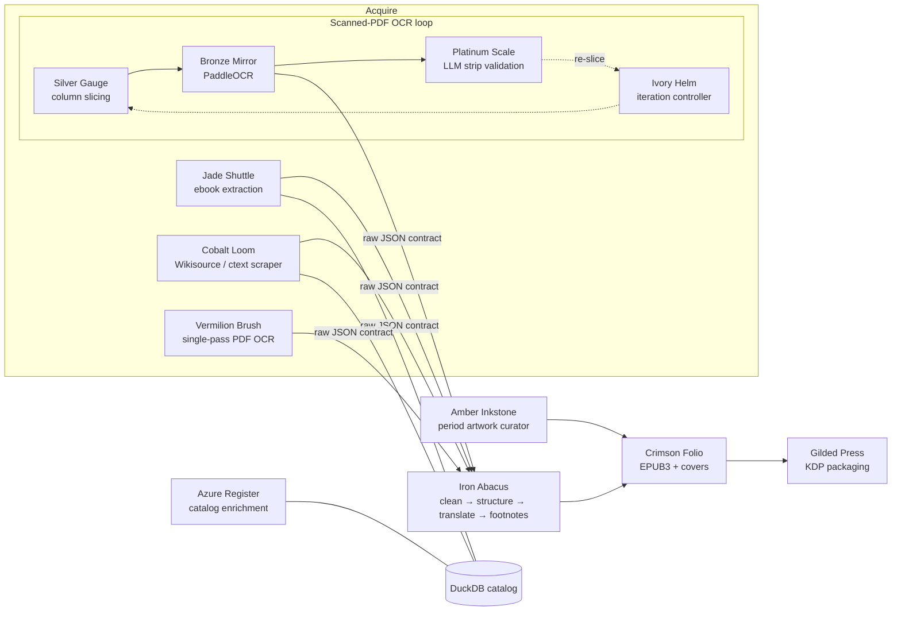

# Iron Abacus Translator

An end-to-end pipeline that turns classical and wuxia Chinese novels into English ebooks for readers. It handles source text from scanned PDFs, ebooks and the web, then cleans and structures it, translates it with useful cultural footnotes, and packages it as a Kindle-ready EPUB.

The codebase is a suite of **12 small, single-purpose products** that hand off through explicit JSON contracts and a shared DuckDB catalog. About 370 Python modules in total.



## What's interesting here

**Footnotes that are worth reading.** A naive LLM translation annotates everything: every name, every sword, every sigh. Stage 6 runs a four-phase filter that removes **93–98% of raw footnotes** and keeps only genuine cultural and historical context:

| Phase | Method | Cost |
|---|---|---|
| 1. Suppress list | 100+ common terms (江湖, 氣, 內功…) matched programmatically | free |
| 1.5. Heuristics | Pattern rules for character names, trivial actions and short notes with no cultural signal, guarded by a cultural-signal regex | free |
| 2. In-context scoring | LLM scores triviality and cultural specificity with paragraph context | batched, 25/call |
| 3. Context-free review | Each unique term + explanation judged *without* the story around it, which catches junk the model forgives in context | batched |

Example: *七劍下天山* chapter 3 went from 359 raw footnotes to 26, all real context (Kangxi Emperor, Wudang, Zhuangzi…).

**Consistent terminology across a whole work.** A term-consistency stage keeps names, martial-arts techniques and places rendered the same way across chapters and volumes. Compound terms are split and footnotes are deduplicated across volumes. A curated Chinese-weapons glossary feeds the translation prompts.

**OCR as a feedback loop, not a single pass.** For scanned vertical-text editions, Ivory Helm drives slice → OCR → validate per page. When a page misses its quality thresholds (kept-strip ratio, character count, empty strips), it re-slices with a different column-detection strategy and tries again. Strip validation uses the OCR *text*, not the image. That costs about $0.002 per chapter, and empty strips skip the API entirely.

**Cheap models, used deliberately.** Translation and scoring run on low-cost models (OpenAI GPT-4.1-nano, DeepSeek) at low temperature. Deterministic steps (suppress lists, heuristics, column detection) run first, so the paid calls only see what's left.

**Production habits.** Translations checkpoint and resume, chapters translate in parallel workers, every stage writes its own work-in-progress output and logs, and validators check TOC alignment, chapter sequence and footnote-marker integrity before anything becomes an EPUB.

## The products

| Product | Role | LLM? |
|---|---|---|
| [`iron_abacus_translator/`](iron_abacus_translator/) | Core pipeline: 8-stage cleaning/validation, 7-stage translation, footnote filtering | OpenAI / DeepSeek |
| [`jade_shuttle/`](jade_shuttle/) | Splits multi-book EPUB collections into individual works; dedups against the catalog | – |
| [`cobalt_loom/`](cobalt_loom/) | Scrapes Wikisource and ctext.org into the same raw JSON contract | – |
| [`silver_gauge/`](silver_gauge/) | Detects vertical text columns in scanned pages and slices strips | – |
| [`bronze_mirror/`](bronze_mirror/) | OCRs strips with PaddleOCR; simplified→traditional, error fixes, reading order | – |
| [`platinum_scale/`](platinum_scale/) | Classifies OCR strips as text / header / noise / blank | GPT-4.1-nano |
| [`ivory_helm/`](ivory_helm/) | Orchestrates the slice → OCR → validate loop with retry strategies | – |
| [`vermilion_brush/`](vermilion_brush/) | Single-pass scanned-PDF OCR with page classification and chapter (回) detection | – |
| [`azure_register/`](azure_register/) | Enriches the DuckDB catalog with bibliographic and reader-facing metadata | DeepSeek |
| [`amber_inkstone/`](amber_inkstone/) | Curates genuine period artwork by dynasty from Wikimedia Commons and the Met | DeepSeek |
| [`crimson_folio/`](crimson_folio/) | Builds EPUB3 with popup footnotes, glossaries and composed covers; Kindle delivery | DeepSeek (covers) |
| [`gilded_press/`](gilded_press/) | Validates and packages EPUB + cover + metadata for Kindle Direct Publishing | – |

Each product has its own `CLAUDE.md` documenting its architecture and CLI.

## Quick start

```bash
cd iron_abacus_translator
python -m venv venv && source venv/bin/activate
pip install -r requirements.txt

# Translate a cataloged work end to end
python -m cli.run_pipeline D1379

# Build the EPUB from the translated JSON
cd ../crimson_folio
python -m cli.build --input /path/to/translated.json --cover
```

Requires `OPENAI_API_KEY` and/or `DEEPSEEK_API_KEY` for the translation stages. The acquisition and OCR products run locally without keys.

## How it was built

Developed with [Claude Code](https://claude.com/claude-code) as a pair programmer. Agent definitions live in [`.claude/agents/`](.claude/agents/), and per-product `CLAUDE.md` files act as the contracts each agent works within.

**Stack:** Python · DuckDB · PaddleOCR · PyMuPDF · OpenCC · Pillow · OpenAI · DeepSeek · EPUB3
